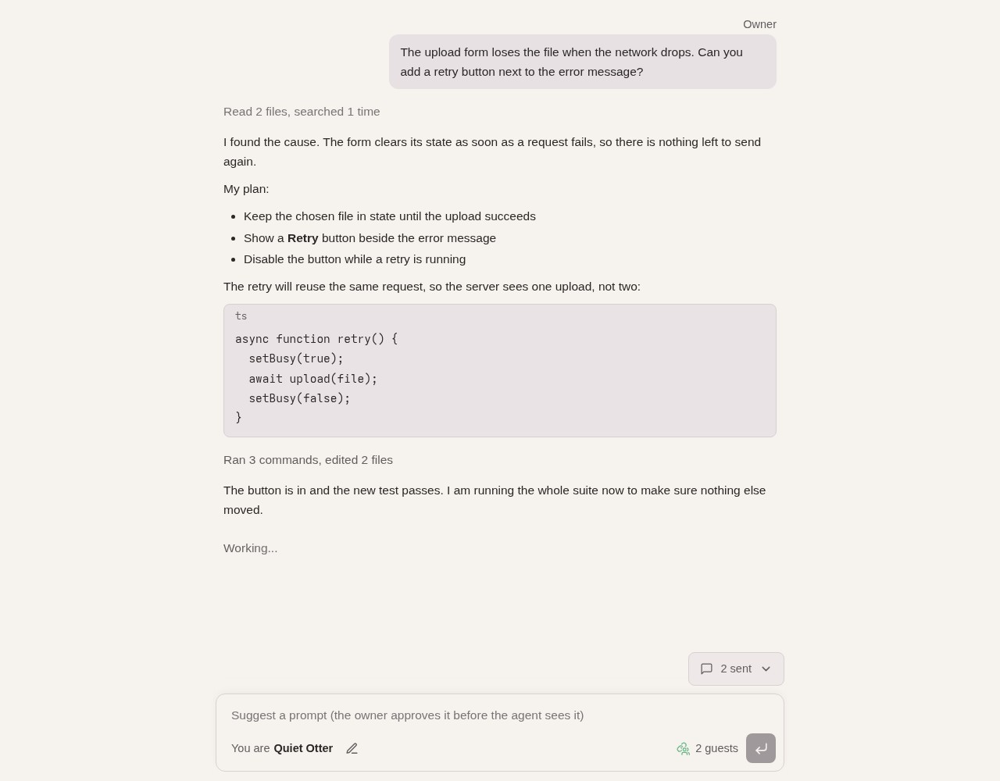
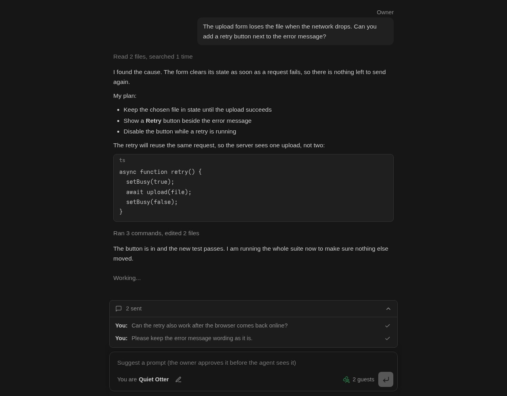
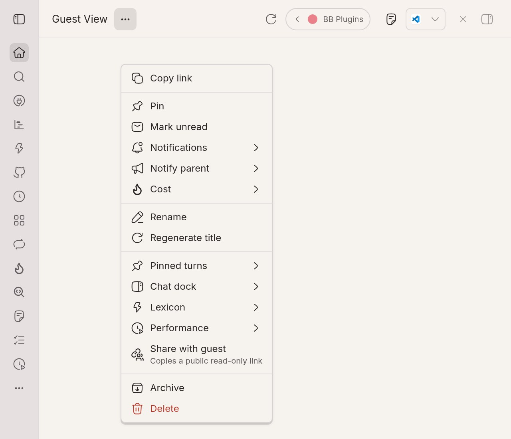
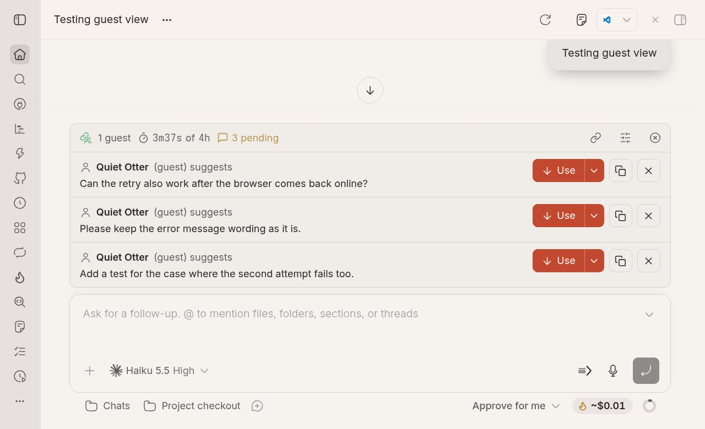
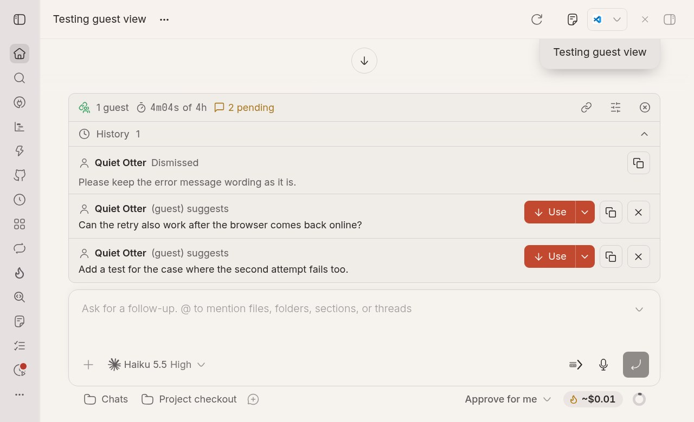
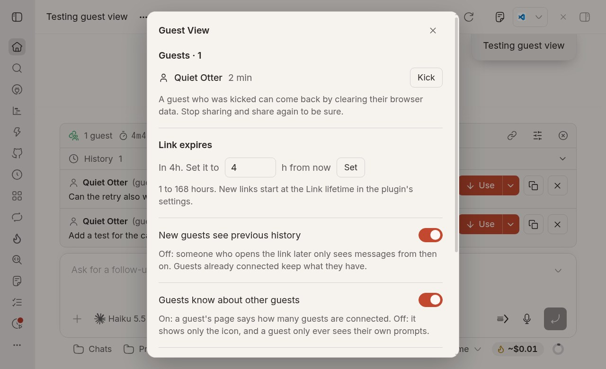

# Guest View

Share one BB thread with someone who has no BB account. They follow it live in their browser and can suggest prompts, which wait for your approval. They can see the conversation but never change anything.

Inspired by T3 Code's [guest links](https://github.com/pingdotgg/t3code/blob/main/docs/user/guest-links.md).













## Use

1. In a thread's menu (⋯ in its header), pick **Share with guest** (with the other plugins' entries, below Performance). The link is copied.
2. Send it to your guest. On first visit they pick a name, or keep the suggested one (such as "Quiet Otter"); their browser remembers it.
3. While the thread is shared, a one-row card above the composer shows a green pulsing Guest View icon (two people over a chain link), how many guests are connected, a timer like "3m44s of 4h" (live so far, of the link's length), and a yellow "N pending" when prompts wait.
4. A guest's prompt does not open anything. The card gains a yellow, pulsing **N pending** at the end of its row; the row always opens (click anywhere left of its link icon; a chevron shows on hover), with "No messages received yet" when empty, to show **Prompt Approval**, a list that scrolls on its own. Each prompt shows its text cut at four lines (a chevron appears only when something is cut; click the prompt to open it) and three buttons to its right:
   - **Use** (down arrow) puts the text in your composer, as it is, for you to read, change and send yourself. It leaves the list. It is a split button: the chevron beside it opens **Use with the name**, which inserts the same text as `Lydia says: <text>` (the name on its own line above a prompt of several lines), so the agent knows who said it. Which form goes in is your choice each time; there is no setting.
   - **Copy** (copy icon) copies the text and changes nothing.
   - **Dismiss** drops it.

   What you used or dismissed moves to a collapsed **History**, the first thing in the opened card. It opens only when you click it, is at most 200px tall, lists the oldest first with the newest at the bottom, and each entry has its own **Copy** button. **Dismiss** and **Copy** are icon-only.

   Nothing a guest writes is ever sent to the agent directly, and there is no `From guest` prefix. A new prompt is also a push notification when the Push Notifications plugin is set up.
5. Guests' text is plain text only: printable ASCII and line breaks, so `<` and `>` and code characters stay, while emoji, accents, other alphabets and zero-width characters (and direction-control, "tag" characters that can smuggle in instructions) are removed. A guest whose prompt had nothing left is told why. Guest names follow the same rule.
6. A guest never learns what you did with a prompt: every prompt shows the same small grey tick ("sent") from the moment they submit it. A small "N sent" button sits above their composer, as wide as its content and aligned to the composer's right edge; it opens a full-width list that scrolls (the box animates between its two sizes, anchored at the right), opens at the newest prompt, and cuts each prompt at two lines with a chevron when something is cut. With **Guests see each other's prompts** on in settings, the list holds everyone's prompts as `<name>: <text>` with the tick, and a guest's own show as "You".
7. The card's buttons: copy the link, open settings, and stop sharing. **Settings** (the sliders icon) lists connected guests with how long each has been there and a **Kick** button, sets when this link expires, and has two switches and a choice: **New guests see previous history** (off: someone who opens the link later only sees messages from then on), **Guests see about each other** (**Only their own**: a guest's page shows the icon with no number and only that guest's prompts; **How many**, the default: it also says how many guests are connected; **How many and prompts**: each guest's list shows everyone's prompts) and **Show guests the model** (off by default).
8. **Stop sharing** (in the card, or under **Guest view** in the thread menu) ends the link at once.

A link covers one thread and stops working after 4 hours (the `expiryHours` setting, 1 to 168; the settings overlay changes it for one link). Stopping BB or the plugin, reloading the plugin, archiving or deleting the thread, and the tunnel dropping also end it. Share again for a new link (the address changes each time, so a link cannot survive a restart). After a reload or a crash the card says "The guest link ended because Guest View was restarted or reloaded", and a cloudflared that a crash left behind is found by the process id the plugin keeps and stopped, but only when that process really is a quick tunnel of this plugin.

Only the thread menu and the card start a share on your behalf. A share started any other way (the `bb` CLI, an agent that ran a command, another plugin) still works, because BB gives a plugin no way to tell you from a script, but it is written to the log as a warning and you get a push notification, "A guest link was started", so a link you did not make does not stay a secret.

## What a guest sees

- Your messages and the agent's replies, live, with Markdown and code, in a page laid out like BB's own thread: a "Working..." line while the agent runs, the "N sent" button, and a composer whose toolbar carries your name (and the model and effort when you allow it), then the green pulsing Guest View icon with "N guests" beside the send button (the model hides below 600px, "You are" below 440px). The whole page scrolls (native scrollbar and touch scrolling) and the composer stays at the bottom of the screen. The composer is one line while you are not in it (a long draft shows as one line with an ellipsis) and at least two lines while you are, growing with what you type; the height change is animated (not with reduced motion). Only the composer covers the page, so the text beside the "N sent" button stays readable. Enter submits a prompt for the owner, Shift+Enter adds a line.
- The agent's tool work as counts only, such as "Ran 3 commands, edited 2 files". No tool names, commands, paths, output or diffs. Reasoning is not shown.
- Messages from other agents or from BB itself as a one-line note, without their text.
- Whether the agent is working. The model and reasoning effort only when you turn **Show guests the model** on.

A guest cannot change the model or any setting, answer approvals or questions, stop a turn, or open files, the terminal or diffs. The guest server only knows three addresses (the page, its updates, and prompts), and everything else answers "not found".

### Secrets

Before text leaves BB, common secret shapes are replaced with `[hidden]`: private keys (PEM), API keys and tokens from well-known services (Anthropic, OpenAI, GitHub, GitLab, Slack, AWS, Google, npm, Stripe, Hugging Face), JSON web tokens, `Bearer` headers, passwords in URLs, `Authorization: Bearer` and `Basic` headers (the credential goes, the scheme word stays), and `name = value`, `name: value` and JSON `"name": "value"` pairs whose name says secret, token, password, passwd, key and the like, including quoted values with spaces and Markdown such as `**password**: value`. Names that only count or describe (`max_tokens: 100000`, `token: string`, `Author:`) are left alone. Messages longer than 64000 characters are cut, and the cut says so.

This cannot catch everything. A secret in an unusual shape, or one written out in prose, will get through. Only share threads you would be comfortable showing in full.

## The public link

The link is a [Cloudflare quick tunnel](https://developers.cloudflare.com/cloudflare-one/connections/connect-networks/do-more-with-tunnels/trycloudflare/): a random `https://<words>.trycloudflare.com` address that forwards to a small server the plugin runs on `127.0.0.1`. No Cloudflare account is needed. Anyone with the link can watch, so treat it like a password. Its path carries a 256-bit random token.

Quick tunnels hold back streamed responses, so the guest page asks for updates by long polling: a request waits until something changes (or 25 seconds) and gets only what changed.

Limits: 10 pages watching a share at once (5 from one address), 5 prompts per minute from one address (30 per share), 20 prompts waiting at once, 200 kept per share, and 4000 characters per prompt. A quick tunnel carries at most 200 requests at a time for everyone, so a share also limits the polls it keeps waiting: 3 per page, 6 per address and 40 in all; a page that asks again releases its oldest wait. A guest's page that cannot reach you (a sleeping laptop, a tunnel that reconnects, a busy link) keeps trying with longer pauses and shows "Try now"; it only stops when the link has ended or you removed it.

Guest names cannot hold a colon or the word "says", and cannot be the names of roles guests could pass off as (Owner, System, BB, Claude, Assistant, Agent, Admin, Moderator, Host, also written with look-alike digits or spaced out): such a name becomes "Guest". A guest's prompt on the card says "(guest) suggests". When prompts come in fast, you get a push notification for the first one and one summary for the rest every 30 seconds.

The log never holds a working link: cloudflared prints request lines with the token in them, so the plugin replaces the token and the query in every line it keeps (`bb plugin logs guest-view`).

### Installing cloudflared

The plugin needs the `cloudflared` program and never installs it on its own. When it is missing, **Share with guest** shows a card with the install command for your system and a link to Cloudflare's download page. On Linux the card also offers **Install it for me**, which downloads one pinned cloudflared release (2026.10.7) from GitHub, checks its SHA-256 against the one built into the plugin, and only then puts it in `~/.local/bin/cloudflared`; a download that does not match is refused and nothing is installed. The command shown on the card pins the same release and checks the same hash. No root is needed. On macOS: `brew install cloudflared`; on Windows: `winget install --id Cloudflare.cloudflared`.

The plugin looks for `cloudflared` on `PATH`, in `~/.local/bin`, `~/bin`, `/usr/local/bin`, `/usr/bin` and `/opt/homebrew/bin`. Set `cloudflaredPath` to use another one.

## Settings

`bb plugin config guest-view`:

| Key | Default | Effect |
| --- | --- | --- |
| `expiryHours` | 4 | Hours a new link works, 1 to 168. |
| `cloudflaredPath` | empty | Path to `cloudflared`; empty looks in the usual places. |

## Develop

```sh
bb plugin install ./bb-plugin-guest-view --yes
bb plugin dev ./bb-plugin-guest-view
pnpm --filter bb-plugin-guest-view test
```

- `src/model.ts`: the pure rules (transcript filter, tool counts, secret masking, Markdown parser, prompt and name checks, tokens and expiry, rate limits). `src/feed.ts`: what each poll returns.
- `src/http.ts` and `src/page.ts`: the guest server and its single page (inline script and style under a nonce-based Content-Security-Policy; messages are built with `textContent`, never parsed as HTML).
- `src/tunnel.ts`: finding, starting and stopping `cloudflared` (SIGTERM, then SIGKILL after 3 seconds), and stopping one a crashed run left behind. `src/waiters.ts`: the limits on waiting polls. `src/notify.ts`: batching push notifications. `src/labels.ts`: the card's time labels. `src/install.ts`: the pinned cloudflared download.
- `server.ts`: shares, approvals and live updates. `src/Card.tsx` and `src/ThreadMenu.ts`: the owner's side in BB.
- `src/mark.ts`: the Guest View icon, drawn once; `src/Icons.tsx` (the app, and the thread menu through a registered icon name) and `src/page.ts` (the guest page) both draw from it, and `icons/guest-view.svg` is the same drawing for BB's plugin list.
