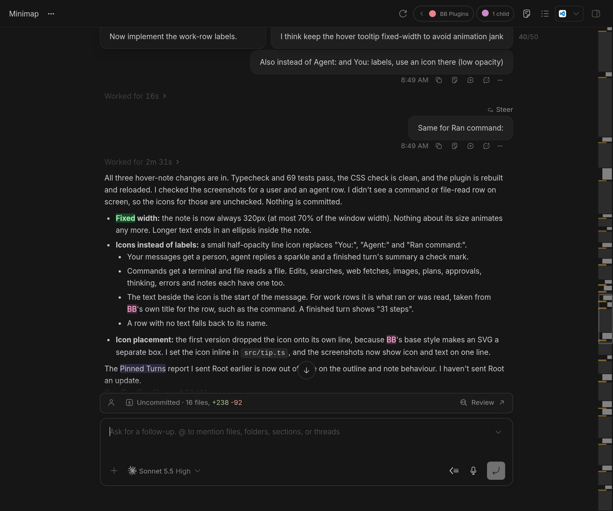
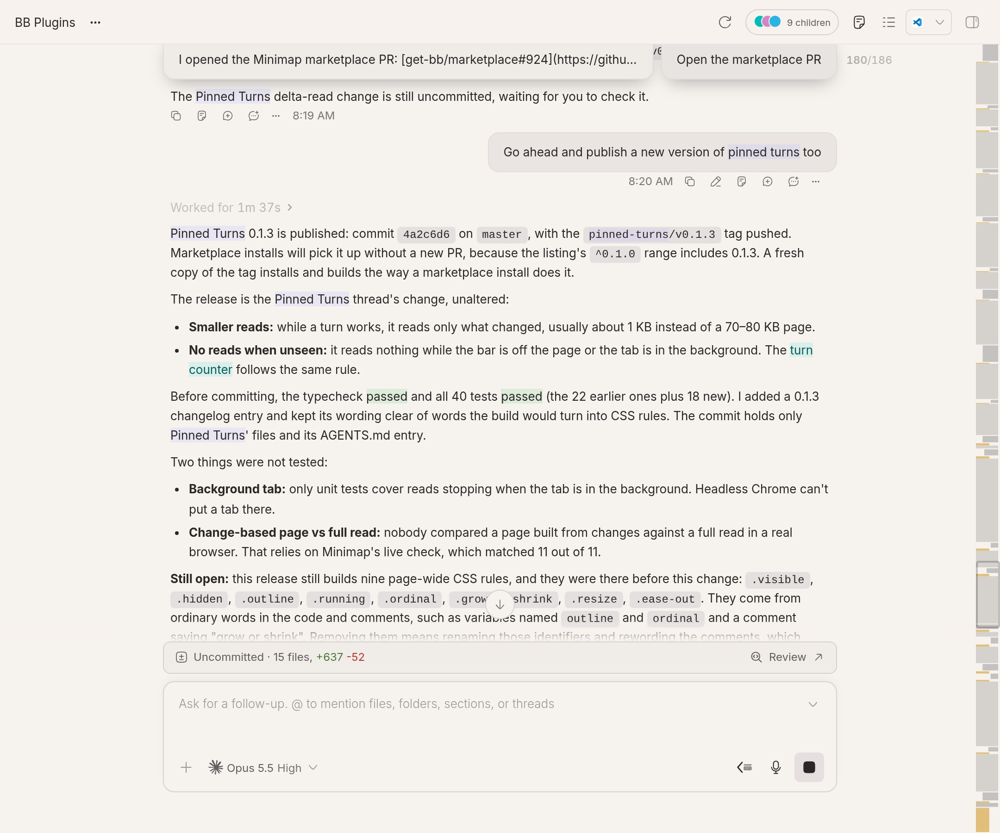
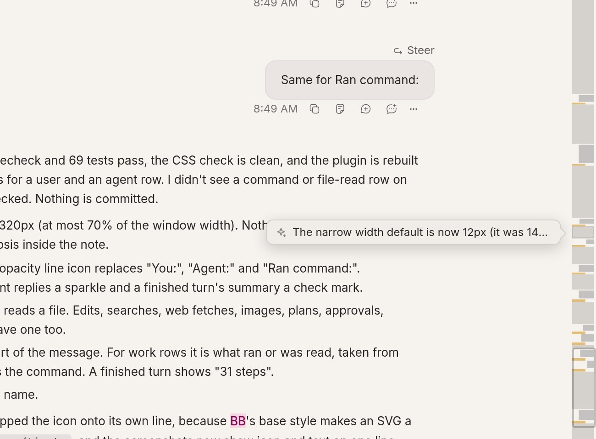
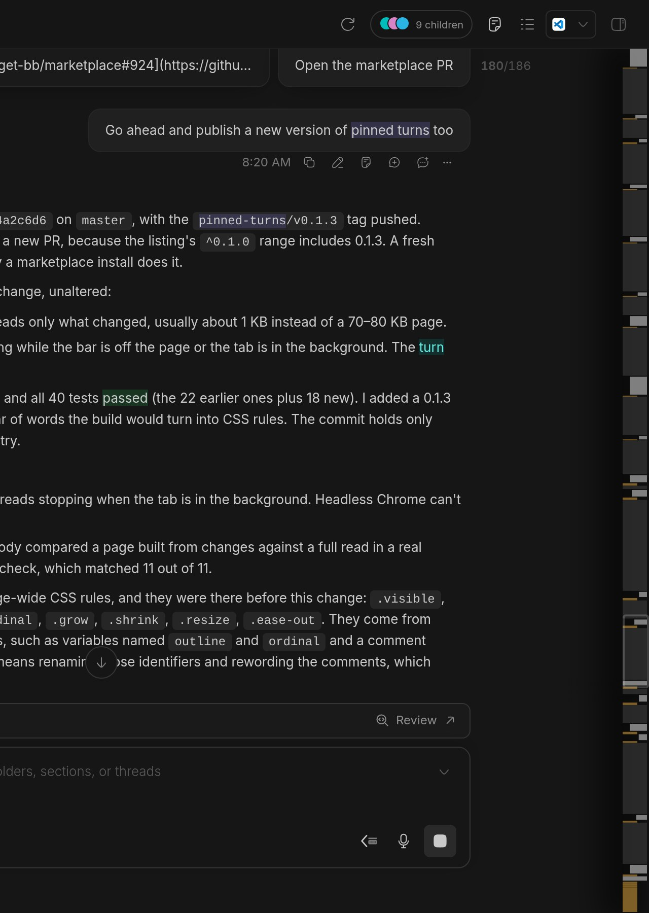
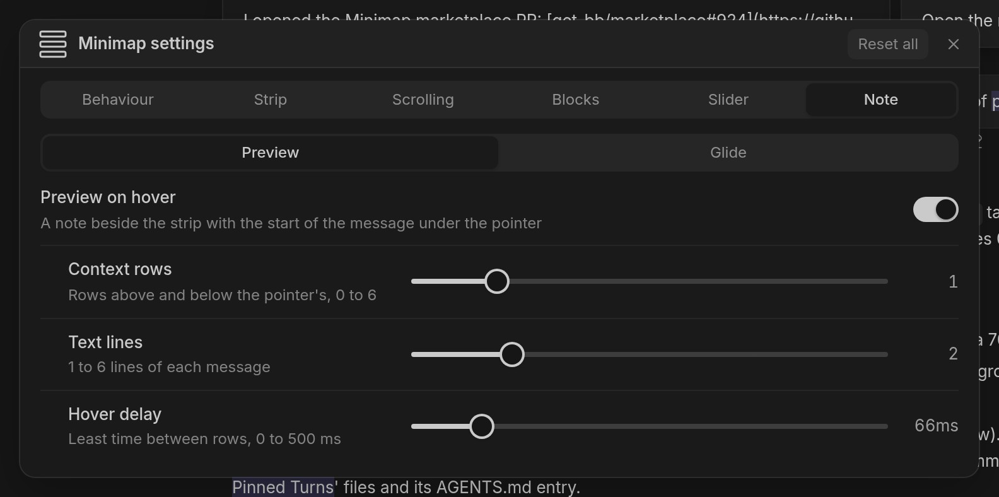
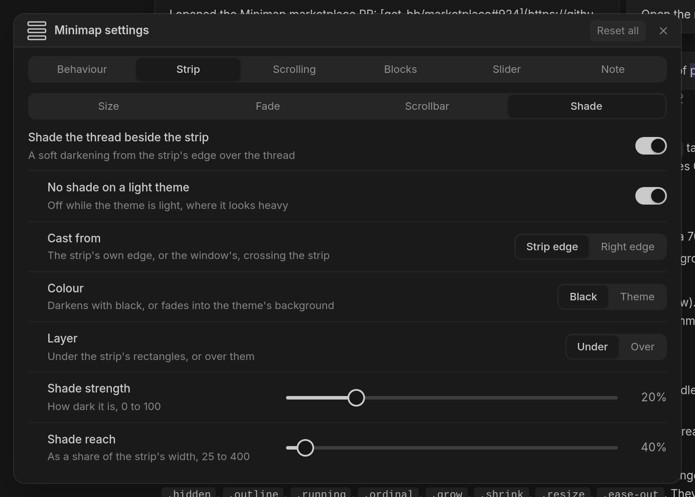
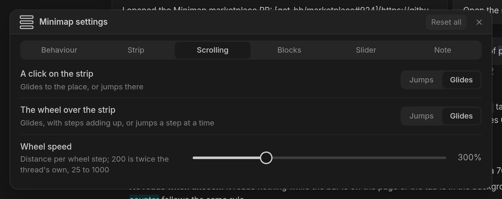

# Minimap

A scrollbar you can read. Minimap puts a strip along the right edge of each BB thread, drawn like VS Code's minimap: one rectangle per message, as tall as the message, coloured by who wrote it. A slider marks the part you are reading. Drag it to scrub, click anywhere on the strip to jump there, or scroll the wheel over it.





## What you get

On a long thread the strip shows its shape at a glance: where your questions are, where the agent worked for a while, where something failed. The colours are:

- your messages: light grey, right-aligned and as wide as the bubble
- agent replies: grey, full width
- work (tool runs and "Worked for" rows): amber
- errors: red
- system notes: faint

Rectangles are drawn to scale, so the strip covers the same ground as the scrollbar and its slider sits where the scrollbar's thumb would. On a very long thread your messages and errors are painted over everything else and never get thinner than two device pixels, so you can still find them.

Hover a rectangle and a note beside the strip shows a small icon for what it is (you, the agent, a command, a file read, a search) and the start of its text, such as the command that ran. The note is a window onto a list: moving to another row glides the list there, softening a little when it passes many rows, and its arrow points at the rectangle, which is outlined in its own colour (that line jumps, it doesn't slide).



BB's own scrollbar fades out and is thin to grab, so Minimap switches it off while the strip is there. If you would rather have both, turn off **Replace the scrollbar**; **Always show the scrollbar** then stops BB fading it. BB's thread-index button is removed by default; turn **Hide the thread-index button** off and it sits just left of the strip. A soft shade falls from the strip's edge over the thread (**Shade the thread beside the strip**, on by default): **Layer** puts it over or under the rectangles, and **Shade strength** and **Shade reach** set how dark and how far. **Cast from** starts it at the strip's edge or the window's, and **Colour** is black or the theme's background. The shade is off on a light theme unless you turn **No shade on a light theme** off. On a phone the settings open as a sheet from the bottom. Clicks and the wheel glide (each can jump instead, on the Scrolling tab), and the wheel over the strip goes **Wheel speed** (default 300%, three times the thread's own) as far.



A thread short enough to have nothing to scroll gets no strip (**Hide when the thread fits**). A thread you have opened recently comes back with the row sizes Minimap already measured, so its strip is right straight away.

## Settings

Pick **Minimap** in a thread's actions menu (the ⋯ in the thread header, or a thread's menu in the sidebar). A settings panel opens over the top left of the chat, so you can watch the strip change while you edit. Drag it by its title bar; Esc or × closes it. **Reset all** asks twice before it puts every option back.



The panel has six tabs (the same panel is also the Minimap section of BB's settings page):

- **Behaviour**: showing the strip, removing the thread-index button, hiding the strip on short threads, and loading the whole history.
- **Strip**: replacing or keeping the scrollbar, width (6 to 120px, 26 by default), opacity, fading when the pointer is elsewhere, what happens on a narrow window, and the shade beside the strip.
- **Scrolling**: whether a click glides or jumps, whether the wheel glides, and how far the wheel scrolls.
- **Blocks**: a colour and an on/off switch for each kind of rectangle. **Theme** puts a colour back to the theme's own.
- **Slider**: the slider's corners, thickness, opacity and colour, or no slider at all.
- **Note**: the hover note on or off, how many rows of context it shows above and below the pointer's (0 to 6, 1 by default; the others are quieter; at the top or bottom of a thread the window moves inward so it is always full), how many lines of each message it shows (1 to 6, 2 by default), whether it glides at all, how long it glides between rows (0 to 1000ms, 420 by default; 0 swaps at once), how soft it gets at the start of a long glide (0 to 12px, 6 by default) and the least time between rows (0 to 500ms, 66 by default).





Sliders and colours preview on the strip as you drag and are saved when you let go. To take the entry out of the thread menu, switch off **Show in thread menus** on the plugin's page in BB's settings.

## Split workspaces

With several threads side by side, each pane gets its own strip, and a pane that closes or switches thread takes or changes its strip within a second. The strip needs the same room beside the thread's column as anywhere else, so a narrow pane shows the narrow width.

## Narrow windows

The full strip needs room beside the message column, about 880px of thread width (more if you keep the thread-index button). When there is less, the strip drops to its narrow width (12px by default) and may overlap the edge of the column. Turn off **Keep on narrow windows** to hand back to BB's scrollbar there instead.

## What it reads

Minimap reads the thread's own timeline through BB's plugin SDK, the same pages BB shows. It starts with the newest page and reads older ones only as BB loads them while you scroll up. While a turn is working it asks only for what changed, a few KB at a time instead of the whole page. It reads nothing while the strip is not shown or the tab is in the background. **Load the whole history** fetches every older page up front, which takes a while and costs more on a long thread, so it is off by default.

No external service or account is used.

## Requirements

- BB 0.49 or later.
- Minimap reads BB's timeline layout, which is not a documented interface, so a future BB release may need a plugin update.

## Develop

```sh
bb plugin install ./bb-plugin-minimap --yes
bb plugin dev ./bb-plugin-minimap
pnpm --filter bb-plugin-minimap test
```

- `src/strip.ts`: the controller that attaches the strip to a thread and runs one layout pass. `src/painter.ts` paints the canvas and animates changes; `src/steering.ts` handles click, drag and wheel.
- `src/model.ts` and `src/boxes.ts`: the pure layout (measured and estimated row heights, mapping to the scroller) and the rectangles to paint.
- `src/timeline.ts` and `src/rows.ts`: reading the timeline as deltas, and turning rows into items with estimated heights.
- `src/shared.ts`: every setting once, with its label, description, default and range. `server.ts` defines the settings and RPCs from it.
- `src/Panel.tsx`: the settings panel. `src/ThreadMenu.ts`: the thread menu entry that opens it.

MIT licensed.
