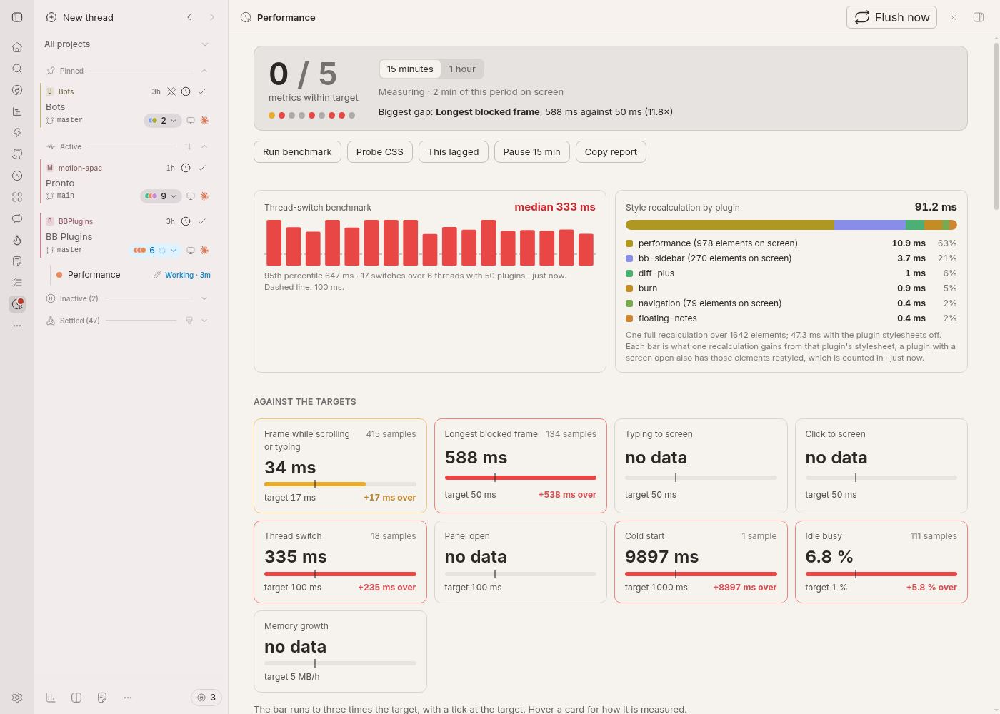
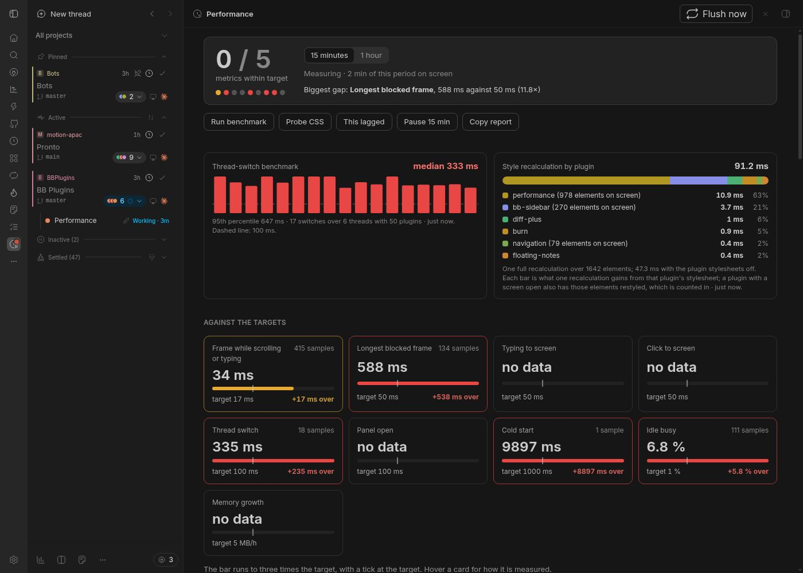
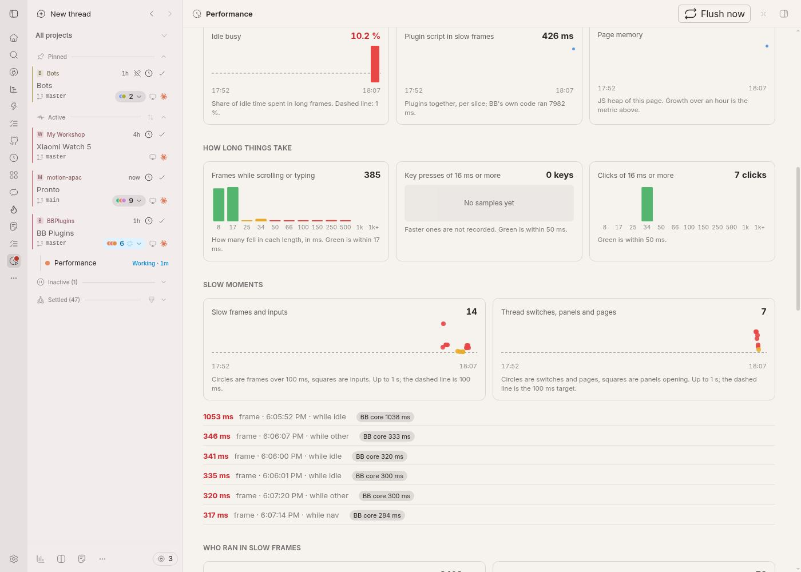
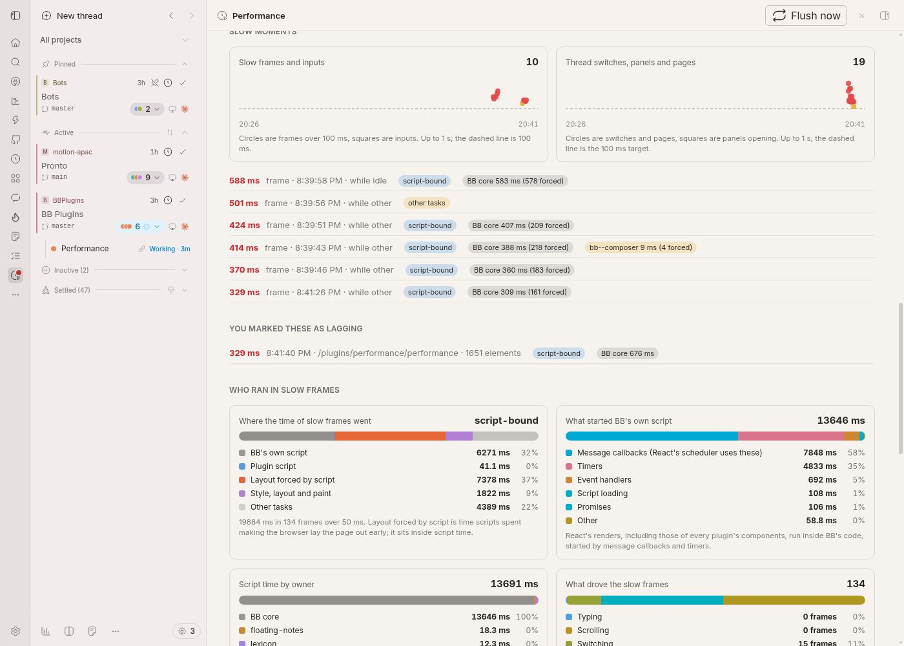
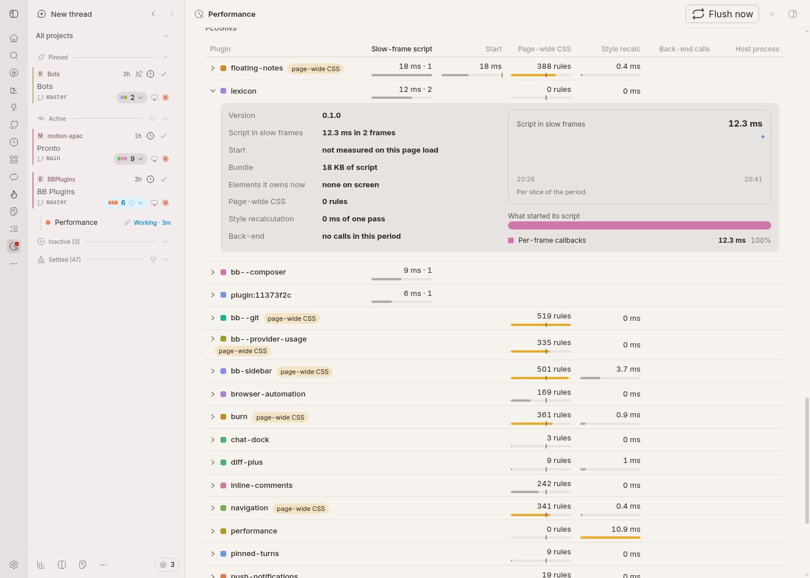
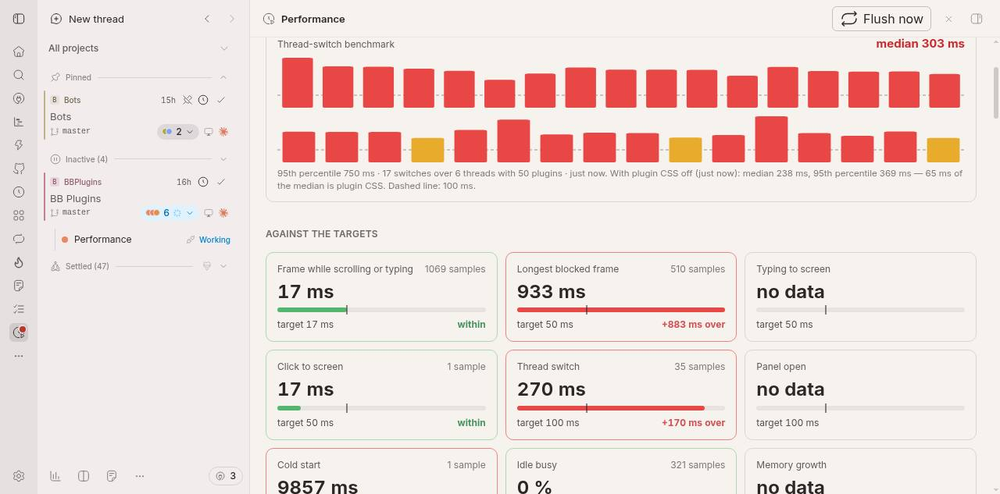
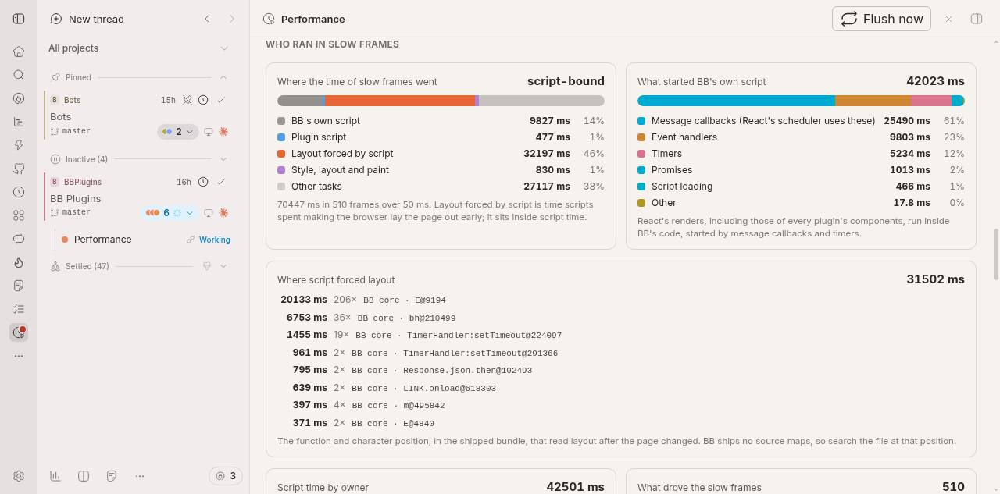

# Performance

A BB plugin that measures how far BB is from feeling native while you use it, and shows which plugin is behind a slowdown. It measures in your real sessions, not in a test run, so the numbers are the ones you feel.

It adds a **Performance** tab to BB's nav. The nav icon carries a badge with the biggest gap as a multiple of its target (`3.2×`), and its tooltip names the metric. The measuring is always on, costs no tokens, and gives the same answer every time; an analyst bot can read the metrics file instead of the dashboard.

## The dashboard

Top to bottom, for the last 15 minutes or the last hour:

- **Score**: how many metrics are within target, one dot each, and the biggest gap.
- **Actions**: Run benchmark, Compare plugin CSS, Probe CSS, This lagged, Pause 15 min and Copy report (see below), and the last benchmark and probe as charts.
- **Against the targets**: a card per metric with a bar that runs to three times the target (a tick marks the target).
- **Over time**: bars per slice for the longest blocked frame, frame time while scrolling or typing, typing latency and idle busy time; lines for plugin script time and the page's memory. A dashed line is the target.
- **How long things take**: the distribution of frame lengths, key presses and clicks, green within target.
- **Slow moments**: every frame or input over 100 ms and every thread switch, panel opening or page change as a dot on a time axis (height is how long); hover a dot for the details. The six slowest are listed under them, each with a verdict: *script-bound* (most of the frame was script), *render-bound* (most was style and layout after the scripts) or *other tasks*, and the scripts that ran, with the layout they forced. A slow input also says how it divided: waiting for the page, its own handlers, or the paint after them, and which owners ran in the frames meanwhile.
- **You marked these as lagging**: the moments you pressed **This lagged**.
- **Who ran in slow frames**: where the time of slow frames went (BB's own script, plugin script, layout forced by script, style, layout and paint, other tasks), what started BB's own script (message callbacks, timers, event handlers, per-frame callbacks), one bar split between BB core and each plugin, and another split by what you were doing (typing, scrolling, switching, idle, clicking or loading).
- **Where script forced layout**: the biggest places in BB's or a plugin's bundle (file, function and character position) where script read layout after the page changed. BB ships no source maps, so the position is searchable in the shipped file; in BB's own bundle the top ones are React's scheduler and its discrete-event dispatch, which is React rendering, not one function to fix.
- **Plugins**: a sortable list with a small bar in each cell, ticks at the thresholds. Each row opens (the arrow beside its name) to show everything known about that plugin.
- **Server**: event loop delay, CPU and memory of BB's server process as lines.

## What is measured

| Metric | Target | How |
| --- | --- | --- |
| Frame while scrolling or typing | 17 ms | 95th percentile gap between frames, sampled only while you scroll or type |
| Longest blocked frame | 50 ms | Long Animation Frames: the longest in the period |
| Typing to screen | 50 ms | Event Timing, key events of 16 ms or more, 95th percentile |
| Click to screen | 50 ms | Event Timing, pointer and click events, 95th percentile |
| Thread switch | 100 ms | median from the route change to the timeline going quiet for 100 ms |
| Panel open | 100 ms | median from the right panel's size change to it going quiet |
| Cold start | 1 s | end of the last long frame in the first 10 s after a page load |
| Idle busy | 1 % | share of idle time spent in long frames (frames while loading do not count) |
| Memory growth | 5 MB/h | slope of the JS heap over the last hour |

A period is the last 15 minutes or the last hour. Only time the tab is on screen counts; a background tab measures nothing.

## Which plugin

The **Plugins** list ranks each installed plugin by what it costs:

- **Slow-frame script**: how long the plugin's own scripts ran inside frames over 50 ms, from the Long Animation Frames API, which names each script's source. Each plugin's bundle has its own URL, so this is exact. A plugin's React components render inside BB's code, so their cost lands under *BB core*: a slow-typing result with no plugin to blame is a suspect, not a verdict.
- **Start**: script time while BB loaded.
- **Page-wide CSS**: how many of the plugin's style rules BB checks against every element (`:where([data-bb-plugin=…]) .word`, which `bb plugin build` makes from every utility word it finds in a plugin's folder). Past 300 rules it is flagged. This was the biggest cost found when profiling a thread switch.
- **Back-end calls**: how many times the plugin's server code ran in the period and how many failed.
- **Host process**: memory and CPU of the plugin's own worker process, for the few plugins that have one. Other plugins' back-ends run inside BB's server process, so they have no figure of their own; the **Server** section shows the event loop delay, CPU and memory of that process as a whole.

### What an opened plugin row shows

Its version; script in slow frames and the layout that script forced; start time; the size of its script bundle; how many elements it owns on screen now; page-wide CSS rules and the class words behind them and, apart, the variants they sit under (`hover`, `max-md`): a bare utility word anywhere in the plugin's folder makes a rule, so the words say what to remove and a variant says which classes carry it; the cost of its stylesheet from the last **Probe CSS**; its back-end calls and, for a plugin with one, its worker process; a chart of its script time in slow frames per slice of the period; what started its script; and its slowest moments.

## Actions

- **Run benchmark**: switches between your six most recent threads three times, times each switch the way the thread-switch metric does, and returns to the tab. The first switch only warms things up and is dropped. Run it before and after a change to compare; the result (median and 95th percentile) stays in the tab and is written as a `bench` line. It reads only thread ids from the server, never titles or messages.
- **Compare plugin CSS**: runs the benchmark twice, the second time with every other plugin's stylesheet switched off (this plugin's own stays on so the tab is readable), and reports the difference in the median switch. Plugins look unstyled for about twenty seconds; the sheets are always switched back on, and nothing is saved on the server except the two `bench` lines.
- **Probe CSS**: switches each plugin's stylesheet off and on in turn and times one style recalculation (style only, no layout), so a plugin's share of the style cost is measured instead of guessed from its rule count. The page freezes for a few seconds while it runs and its own frames are not counted. A plugin with a screen open also has those elements restyled, so the elements it has on screen are shown beside its time; the Performance tab itself is always in that position.
- **This lagged**: keeps what the last 15 seconds looked like (long frames, how they divide, which owners ran, the route with ids removed, how many elements the page held) for when you felt a lag and want to find it later. Also in the **Performance** thread menu.
- **Pause 15 min** stops measuring; what is gathered stays. **Resume** ends it.
- **Copy report**: a markdown summary of the targets, where slow-frame time went, the worst plugins, the slowest moments, your marks and the last benchmark, comparison and probe, with the switches, forced-layout sites and input phases, to paste into a thread for an agent.

## The metrics file

Each day goes to `~/.bb/plugins/performance/metrics/YYYY-MM-DD.jsonl`, appended about once a minute (and when you leave the tab). Files older than 14 days are deleted; a file stops growing at 5 MB. The first line of a file says the targets; then one JSON object per line, with `kind` one of:

- `window`: a period of use: frame and input histograms (bucket edges 8, 17, 25, 34, 50, 66, 100, 150, 250, 500, 1000 ms), long frames by what drove them, idle busy time, script time per plugin (with the layout it forced and what started it), `sites`, the biggest places that forced layout (file, function, character position), and `split`, how the long frames divide into script, forced layout, style and layout, and other tasks.
- `slow`: one frame or input over 100 ms, with what you were doing, the plugins whose scripts ran in it (with forced layout and what started each) its `split` and, for an input, `phases` (wait, handlers, paint) (at most 5 per minute).
- `nav`: a thread switch, page change or panel opening and how long it took to settle, with the route (ids removed).
- `start`: cold start and each plugin's start time.
- `css`: page-wide CSS rules per plugin, and `words`, the class words behind them (a key ending in `:` is a variant, such as `hover:`).
- `mark`: a press of **This lagged**.
- `bench`: a thread-switch benchmark: each switch's time, median and 95th percentile (`cssOff` marks the run with plugin stylesheets off).
- `probe`: a style probe: one recalculation with and without the plugin stylesheets, and the time each plugin's adds.
- `server`: one sample a minute of the server process and plugin workers, with back-end call counts per plugin.

No message text, file names, titles or ids are written. `bb performance summary [--json]` prints the headline numbers from the file, and `bb performance files` the folder.

## Options

In **Performance** in a thread's actions menu (⋯ in the thread header, or a sidebar row's menu), each a check beside the ones that are on:

- **Measure**: switch the measuring off; nothing is attached to the page then.
- **Write the metrics file**.
- **Sample the server**: the once-a-minute server line.

The same three are plugin settings, and **Open the dashboard** is in the menu too.

## Cost

The plugin must not be the cost it measures. It samples instead of recording each frame (frames are timed only within 0.4 s of a key, scroll or click), keeps one 12-bucket histogram per metric, writes once a minute, and attaches nothing while it is off. The benchmark and the probe run only when you press them; the probe freezes the page for a few seconds. The dashboard shows how long its own callbacks ran in the period, under **This plugin**.

## Requirements and limits

- BB 0.48 or later. Event Timing, Long Animation Frames and `performance.memory` need a Chromium-based page, which BB's desktop and browser use.
- Per-plugin server cost is not split out (see above). To compare with a plugin off, use `bb plugin disable` or `bb plugin safe-mode`; the plugin never does that itself.
- A headless browser draws on the CPU, so its frame times are far worse than your screen's. Read the numbers from your own sessions.
- No external service or account is used.
